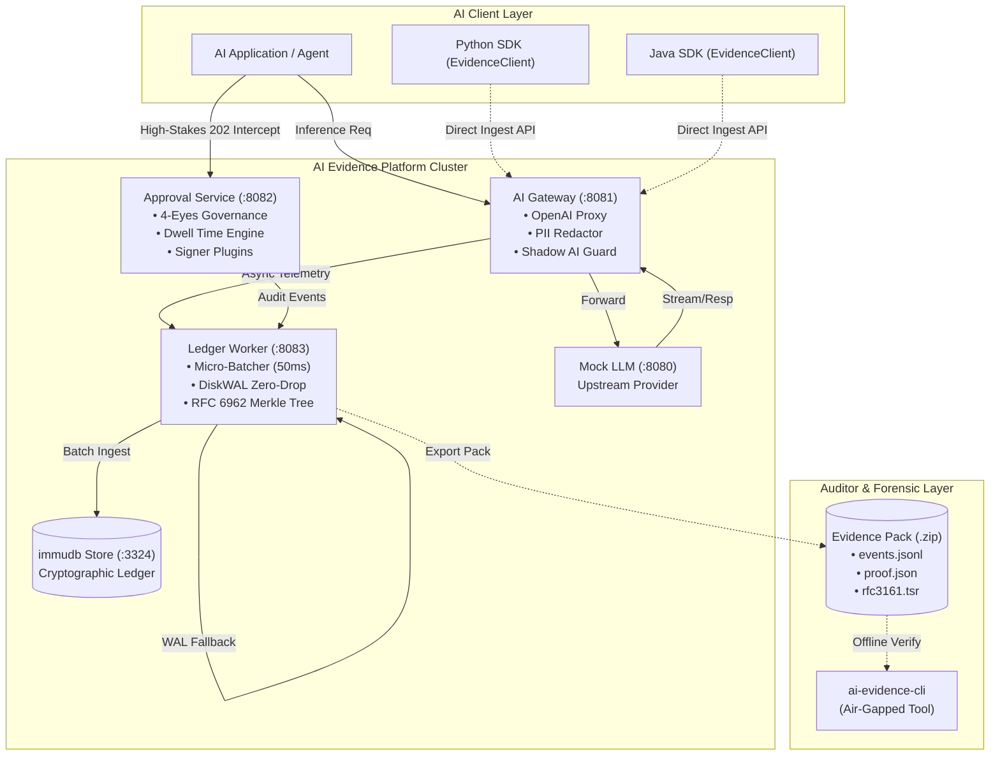

# AI Evidence & Accountability Platform (v0.3)

[](docs/explanation/resilience-and-zero-drop.md)
[](docs/explanation/architecture-and-cryptography.md)
[](LICENSE)
[](COMMERCIAL.md)
[](https://vietcrm.com)
[](https://vietcrm.com)

> **Enterprise-grade, tamper-evident audit ledger and governance gateway for AI systems.**  
> Captures prompts, LLM inferences, and high-stakes agentic actions into cryptographic Merkle trees with zero latency impact on core AI workloads.

---

## 1. Executive Summary & Core Capabilities

Modern enterprise AI deployments face stringent regulatory audits (EU AI Act, ISO/IEC 42001, SOC 2 Type II). **AI Evidence & Accountability Platform** intercepts, redacts, logs, and gates AI interactions without becoming a bottleneck or single point of failure:

* **Non-Blocking Ingestion (< 5ms SLA)**: Asynchronous bounded ring-buffer logging ensures AI model inference is never blocked, even during total downstream ledger outages.
* **Cryptographic Tamper-Evidence**: Real-time SHA-256 Merkle tree anchoring backed by immutable ledger storage ([immudb](https://codenotary.com/technologies/immudb/)), canonical JSON serialization ([RFC 8785 JCS](https://www.rfc-editor.org/rfc/rfc8785)), and external time-stamping ([RFC 3161 TSA](https://www.rfc-editor.org/rfc/rfc3161)).
* **Strict 4-Eyes Human Approval**: Fine-grained state machine for high-stakes agent actions with cryptographic separation of duties (proposer cannot approve), Dwell Time anti-rubber-stamping, and pluggable digital signatures (Internal RSA-PSS, VN CA USB Token, VN Remote Signing).
* **Air-Gapped Offline Verification**: Standalone CLI verification tool (`ai-evidence-cli`) for forensic auditors to validate cryptographic proofs without network access or database credentials.

---

## 2. High-Level Architecture



---

## 3. Documentation Navigator (Diataxis Framework)

The project documentation is organized into four distinct quadrants according to the **Diataxis Framework**:

```
docs/
├── tutorials/       # Learning-oriented: Zero to working deployment in 15 minutes
├── how-to/          # Task-oriented: Step-by-step guides for common operational problems
├── reference/       # Information-oriented: Exhaustive technical specs, APIs, and schemas
└── explanation/     # Understanding-oriented: Deep architectural and cryptographic rationale
```

| Quadrant | Document | Description | Target Audience |
|:---|:---|:---|:---|
| **Root Blueprint** | [Architecture Blueprint](ARCHITECTURE.md) | Comprehensive system architecture, trust boundaries, technology choices, and data flow. | System architects, Tech leads |
| **Root Guidelines**| [Contributing Guide](CONTRIBUTING.md) | Development workflow, coding standards (Go, Python, Java), test suites, and security policy. | Engineers, Contributors |
| **Root Changelog** | [Project Changelog](CHANGELOG.md) | Release history, breaking changes, and version milestones (v0.1.0 to v0.3.0). | All stakeholders |
| **Root License**   | [AGPL-3.0 License](LICENSE) | Open-source copyleft license terms governing community usage. | All users, Legal |
| **Root Commercial**| [Commercial Terms](COMMERCIAL.md) | Enterprise licensing, proprietary closed-source exemptions, and SLAs. | Enterprise buyers, Legal |
| **Tutorial** | [Getting Started](docs/tutorials/getting-started.md) | 15-minute hands-on walkthrough: Start cluster, route LLM traffic, redact PII, execute 4-eyes approval, and verify evidence offline. | New developers, evaluators |
| **How-To** | [Deploy Cluster](docs/how-to/how-to-deploy-cluster.md) | Production Docker Compose cluster deployment, volume management, and healthcheck verification. | DevOps, SREs |
| **How-To** | [Integrate Gateway](docs/how-to/how-to-integrate-gateway.md) | Route OpenAI SDKs through the gateway, configure regex PII rules, block Shadow AI, and configure 202 Intercepts. | AI engineers, Backend devs |
| **How-To** | [Use Client SDKs](docs/how-to/how-to-use-client-sdks.md) | Integrate non-blocking client SDKs in Python and Java applications with bounded queue semantics. | Software engineers |
| **How-To** | [Manage Approvals](docs/how-to/how-to-manage-approvals.md) | Review high-stakes AI decisions, fulfill Dwell Time requirements, and sign approval manifests on Web UI. | Compliance officers, Reviewers |
| **How-To** | [Verify Evidence Pack](docs/how-to/how-to-verify-evidence-pack.md) | Inspect and verify portable evidence packs offline using `ai-evidence-cli` in air-gapped environments. | External auditors, Legal teams |
| **How-To** | [SRE Incident Runbook](docs/how-to/sre-incident-runbook.md) | Incident response playbook for immudb downtime, DiskWAL recovery, queue saturation, and verification failures. | SREs, On-call engineers |
| **Reference** | [REST API Reference](docs/reference/api-reference.md) | Complete endpoints, JSON payloads, headers, and error codes for Gateway, Approval, and Ledger services. | API consumers, Integrators |
| **Reference** | [OpenAPI 3.0 Spec](docs/reference/openapi.yaml) | Machine-readable OpenAPI / Swagger 3.0 YAML specification for all microservices. | Tooling, SDK generators |
| **Reference** | [CLI Tool Reference](docs/reference/cli-reference.md) | Command syntax, flags, subcommands (`verify`, `pack`, `inspect`), and exit codes (0–6) for `ai-evidence-cli`. | Automation scripts, Auditors |
| **Reference** | [SDK Reference](docs/reference/sdk-reference.md) | Class hierarchies, interfaces, and methods for Python and Java SDKs. | Developers |
| **Reference** | [Configuration Reference](docs/reference/configuration-reference.md) | Environment variables, timeouts, queue sizing, and `registry.json` specifications. | SREs, Administrators |
| **Explanation**| [Architecture & Cryptography](docs/explanation/architecture-and-cryptography.md) | Threat model, RFC 6962 Merkle tree algorithm, RFC 8785 canonicalization, and immudb integration. | Security architects |
| **Explanation**| [Governance & 4-Eyes Principle](docs/explanation/governance-and-four-eyes.md) | 5-state machine transitions, separation of duties, Dwell Time anti-bypass, and digital signature models. | Compliance architects |
| **Explanation**| [Resilience & Zero-Drop](docs/explanation/resilience-and-zero-drop.md) | SLA guarantees (< 5ms), bounded ring buffers, DiskWAL self-healing, and socket churn mitigation. | Infrastructure architects |

---

## 4. Quick Start (< 3 Minutes)

### Step 1: Boot the Platform Cluster

Start all 5 core containers using Docker Compose:

```bash
docker compose up -d --build
```

Verify service readiness via healthcheck:

```bash
# Gateway (:8081), Approval (:8082), Ledger (:8083), Mock LLM (:8080), immudb (:3324)
curl -s http://localhost:8081/health | grep '"status":"ok"'
```

### Step 2: Route an AI Request through the Gateway

Send an OpenAI-compatible completion request. Notice how sensitive PII is automatically scrubbed before reaching the upstream model:

```bash
curl -X POST http://localhost:8081/v1/chat/completions \
  -H "Content-Type: application/json" \
  -H "X-AI-System-ID: credit-risk-engine" \
  -H "X-User-ID: agent-007" \
  -d '{
    "model": "gpt-4o",
    "messages": [
      {"role": "user", "content": "Customer Nguyen Van A with email nguyen.a@example.com requested 50,000 USD limit."}
    ]
  }'
```

### Step 3: Verify the Cryptographic Evidence Pack

Export and cryptographically verify the audit trail using the standalone CLI:

```bash
# 1. Trigger micro-batch flush & pack creation
curl -s -X POST http://localhost:8083/api/v1/ledger/flush
curl -s -X POST "http://localhost:8083/api/v1/ledger/export?system_id=credit-risk-engine" -o evidence_pack.zip

# 2. Run offline cryptographic verification (Exit code 0 = Verified)
./ai-evidence-cli verify evidence_pack.zip --verbose
```

---

## 5. Port & Service Mapping

| Service | Port | Protocol | Purpose | Health Endpoint |
|:---|:---|:---|:---|:---|
| **Gateway** | `8081` | HTTP/REST | AI reverse proxy, PII scrubbing, shadow AI guard | `GET /health` |
| **Approval** | `8082` | HTTP/REST | 4-Eyes approval state machine, Web UI, digital signer | `GET /health` |
| **Ledger Worker** | `8083` | HTTP/REST | Batching engine, DiskWAL buffer, immudb ingestion | `GET /health` |
| **immudb** | `3324` / `3322` | HTTP / gRPC | Tamper-evident immutable database storage | Web console (`:3324`) |
| **Mock LLM** | `8080` | HTTP/REST | Upstream OpenAI v1 compatible testing server | `GET /health` |

---

## 6. Offline Verification Tool (`ai-evidence-cli`)

The forensic verification CLI operates in air-gapped environments without network or database dependencies:

```bash
# Verify cryptographic Merkle integrity and digital signatures
ai-evidence-cli verify <evidence_pack.zip> [--pubkey <path>] [--verbose]

# Inspect metadata and audit events without full verification
ai-evidence-cli inspect <evidence_pack.zip>

# Assemble an evidence pack from raw event logs
ai-evidence-cli pack --input <events.jsonl> --output <pack.zip> --sign-key <key.pem>
```

### CLI Exit Codes

| Code | Status | Meaning |
|:---:|:---|:---|
| `0` | **VERIFIED** | Cryptographic integrity confirmed. All Merkle proofs and signatures valid. |
| `1` | **INVALID_MERKLE** | Tampering detected. Leaf hash mismatch or root hash mismatch. |
| `2` | **INVALID_SIGNATURE** | RSA-PSS or ECDSA digital signature is forged or corrupted. |
| `3` | **MALFORMED_PACK** | ZIP archive corrupt, `manifest.json` missing, or schema invalid. |
| `4` | **SCHEMA_ERROR** | Event JSON does not comply with RFC 8785 JCS canonicalization. |
| `5` | **POLICY_VIOLATION** | 4-Eyes rule violated (proposer self-approved) or Dwell Time bypassed. |
| `6` | **IO_ERROR** | File not found, permission denied, or disk error. |

---

## 7. Client SDKs

The platform provides official SDKs supporting fire-and-forget, non-blocking telemetry logging:

### Python (`ai_evidence_sdk`)

```python
from ai_evidence_sdk import EvidenceClient, EventPayload

client = EvidenceClient(gateway_url="http://localhost:8081", system_id="kyc-service")

# Fire-and-forget: returns immediately (< 1ms)
client.log_event(
    event_type="prompt_evaluation",
    payload={"action": "identity_check", "status": "passed"},
    user_id="user-123"
)
client.shutdown()
```

### Java (`com.aievidence.sdk`)

```java
import com.aievidence.sdk.EvidenceClient;
import java.util.Map;

EvidenceClient client = new EvidenceClient.Builder()
    .gatewayUrl("http://localhost:8081")
    .systemId("risk-calculator")
    .build();

// Asynchronous execution via CompletableFuture
client.logEventAsync("credit_assessment", Map.of("score", 780, "tier", "A"));
client.close();
```

---

## 8. Development & Testing

Run all unit, integration, and end-to-end tests locally:

```bash
# 1. Run Python SDK tests
pytest sdks/python/tests/ -v

# 2. Run Java SDK tests
cd sdks/java && mvn clean test && cd ../..

# 3. Run Go service tests
cd services/gateway && go test ./... && cd ../..
cd services/ledger && go test ./... && cd ../..
cd services/approval && go test ./... && cd ../..

# 4. Run Full E2E & Adversarial Security Test Suite
pytest tests/e2e/test_master_verification.py -v
```

---

## 9. Security & Governance Standards

* **RFC 6962**: Certificate Transparency Merkle Tree Hash Calculation
* **RFC 8785**: JSON Canonicalization Scheme (JCS) deterministic hashing
* **RFC 3161**: Internet X.509 Public Key Infrastructure Time-Stamp Protocol
* **Decree 13/2023/ND-CP**: Personal Data Protection Decree (PDPD) compliance for Vietnamese identifiers
* **Circular 22/2020/TT-BTTTT**: National digital signature requirements for enterprise banking and government services

---

## 10. Dual-Licensing & Commercial Options

This project is made available under a **Dual-Licensing Model**:
* **Open Source Edition (AGPL-3.0)**: Free to use, inspect, modify, and run internally. If you modify this platform and provide it as a network service to external users, you are legally required to release the source code of your modifications under the [AGPL-3.0 License](LICENSE).
* **Commercial Enterprise License**: For organizations that wish to embed, integrate, or bundle the platform into proprietary SaaS or closed-source products without copyleft disclosure requirements. Includes commercial indemnification, enterprise HSM connectors, SIEM forwarders, and 24/7 SLA.

For commercial inquiries, licensing quotes, or custom enterprise integration, visit [vietcrm.com](https://vietcrm.com), refer to [COMMERCIAL.md](COMMERCIAL.md), or contact `huytran@vietcrm.com`.

---

## 11. Legal & Regulatory Disclaimer

> [!CAUTION]
> **LEGAL NOTICE**: This software is provided "as is", without warranty of any kind, express or implied. In no event shall the authors or copyright holders be liable for any claim, damages, regulatory penalties, or other liability arising from the use of this software or decisions made by autonomous AI models processed through this gateway.
> 
> Deploying this platform assists with compliance under **EU AI Act**, **ISO/IEC 42001**, and **Decree 13/2023/ND-CP**, but does not automatically constitute certified legal compliance. Organizations are responsible for conducting independent risk assessments and legal verification with their certified compliance officers.

---

## 12. Author & Professional Services

This platform is engineered and maintained by **Huy Tran** ([vietcrm.com](https://vietcrm.com)).

Looking to implement enterprise-grade AI governance, secure high-stakes LLM agents, or integrate custom digital signature hardware for your organization?
* **Website**: [https://vietcrm.com](https://vietcrm.com)
* **Direct Inquiries**: `huytran@vietcrm.com`
* **Consulting Services**: AI System Architecture, PDPD / Decree 13 Compliance Audits, Enterprise CRM & Intelligent Workflow Automation.

---
*Copyright © 2026 Huy Tran (VietCRM - https://vietcrm.com). All rights reserved.*
